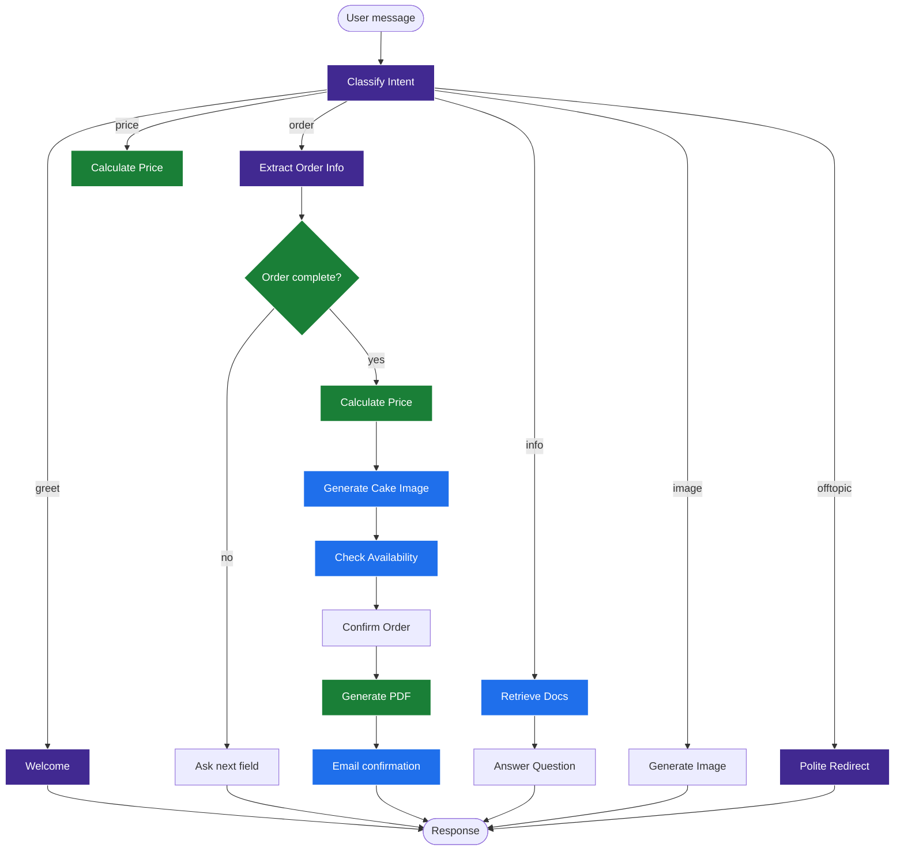

<div align="center">

# 🍰 Kidstorte — AI Cake-Ordering Agent

### Production-ready Multi-Agent platform that turns natural-language conversations into structured cake orders — with image generation, pricing engine and live calendar integration.

[](https://www.python.org)
[](https://fastapi.tiangolo.com)
[](https://langchain.com/langgraph)
[](https://www.trychroma.com)
[](https://openai.com)
[](https://www.docker.com)

[Quick Demo](#-demo) · [Architecture](#-architecture) · [Tech Stack](#-tech-stack) · [Quickstart](#-quickstart) · [Why this matters](#-why-this-matters)

</div>

---

## ✨ What it does

A real-world implementation of a **conversational ordering agent** for a confectionery business:

1. 💬 Customer chats naturally: *"I'd like a chocolate cake for 12 people, my daughter's birthday next Saturday."*
2. 🧠 The system extracts entities (size, flavor, occasion, date), checks calendar availability, calculates a **deterministic price** (no LLM hallucination on critical paths), and generates a **DALL·E preview** of the cake.
3. ✅ Returns a structured order with PDF confirmation — ready for the baker.

> Built as a learning project at **Masterschool** — turned into a production-ready platform with full observability, multi-user session management and cost-control mechanisms.

---

## 🎬 Demo

> **📸 Screenshots:** see [`docs/screenshots/`](docs/screenshots/) · **🎥 Video walkthrough:** *(add Loom link)*

| Conversational Flow | DALL·E Generation | Admin Dashboard |
|:---:|:---:|:---:|
|  |  |  |
| Intent classification + slot filling | Cake preview before order | Orders, ratings, cost monitoring |

---

## 🏛 Architecture

### Multi-Agent State Graph (LangGraph)



🟣 **LLM nodes** — natural language understanding (GPT-4o-mini)
🟢 **Deterministic rules** — pricing, validation (NO hallucination)
🔵 **I/O** — RAG, image generation, calendar, email

### System Diagram

```
            ┌─────────────────────────────────────────────────────────┐
            │   FastAPI · 32 routes · Async                           │
            │                                                         │
   USER ──► │  /api/chat       /api/calendar     /admin/*             │
            │  Bearer-Auth     cookie-session    role-based           │
            └─────────────┬───────────────────────────────────────────┘
                          │
            ┌─────────────▼─────────────────────────────────────┐
            │   LangGraph StateGraph                            │
            │   classify → extract → price → image → confirm    │
            └─────┬──────────┬──────────┬──────────┬────────────┘
                  │          │          │          │
            ┌─────▼─┐   ┌────▼───┐  ┌───▼────┐ ┌───▼────────┐
            │ GPT-4o│   │ Pricing│  │ DALL·E │ │  ChromaDB  │
            │  mini │   │ Engine │  │   3    │ │  (RAG-DB)  │
            │  LLM  │   │  RULES │  │  IMG   │ │ Sentence-  │
            │       │   │        │  │  GEN   │ │ Transformer│
            └───────┘   └────────┘  └────────┘ └────────────┘

            ┌────────────────────────────────────────────────────┐
            │  Observability — LangSmith tracing                 │
            │  Metrics — Prometheus-style /metrics endpoint      │
            │  Cost control — Admin dashboard, daily budget cap  │
            └────────────────────────────────────────────────────┘

            ┌────────────────────────────────────────────────────┐
            │  Persistence — SQLite (orders, ratings)            │
            │                ChromaDB (RAG knowledge base)       │
            │                File-system (PDFs, AI images)       │
            └────────────────────────────────────────────────────┘
```

---

## 🚀 Key Features

### 🧠 AI / RAG
- **5 specialized LLM nodes** orchestrated via **LangGraph StateGraph**
- **RAG with ChromaDB** — knowledge base for cake info, allergies, FAQs
- **DALL·E 3** integration with response caching
- **LangSmith** tracing for every request (debug-friendly)

### 🛡️ Production Engineering
- **Deterministic pricing engine** — rule-based calculation eliminates LLM hallucinations on monetary values
- **Cost-optimization layer** — admin dashboard with token usage, daily budget cap, model fallback
- **Multi-user session management** — concurrent customers without state leakage
- **Response caching** — image and answer caching reduces API costs ~40 %

### 🔌 Integrations
- **Cal.com API** — live calendar availability check
- **SMTP / SendGrid** — order confirmation via email
- **ReportLab** — PDF order summaries with images and pricing

### 🚢 DevOps
- **Multi-stage Dockerfile** — ~250 MB runtime image, non-root user, healthcheck
- **docker-compose** with optional nginx + Let's Encrypt
- **Zero-downtime update pipeline** — build → health-test → rollout → automatic rollback on failure
- **Volume-backup scripts** — pause-aware, retention policy, restore-tested
- **Optional monitoring stack** — Prometheus + Grafana + Loki

---

## 🧰 Tech Stack

| Layer | Technology |
|---|---|
| **Language** | Python 3.11 |
| **Web framework** | FastAPI 0.133 (async, OpenAPI) |
| **AI orchestration** | LangGraph (StateGraph), LangChain |
| **LLM** | OpenAI GPT-4o-mini |
| **Image generation** | DALL·E 3 |
| **RAG / Vector DB** | ChromaDB + Sentence-Transformers |
| **Database** | SQLite (orders), ChromaDB (knowledge) |
| **Templates** | Jinja2 |
| **PDF** | ReportLab |
| **Observability** | LangSmith, Prometheus-style /metrics |
| **Container** | Docker (multi-stage), docker-compose |
| **Reverse proxy** | nginx + Let's Encrypt (production) |

---

## ⚡ Quickstart

### With Docker (recommended)

```bash
# 1. Clone & configure
git clone https://github.com/<your-username>/kidstorte-longchain.git
cd kidstorte-longchain
cp .env.example .env
# → put your OPENAI_API_KEY in .env

# 2. Build & run
docker compose -f docker-compose.local.yml up -d --build

# 3. Open browser
open http://localhost:8080
```

The chat is on the home page. Admin dashboard at `/admin/login` (password in `.env`).

### Without Docker

```bash
python -m venv .venv && source .venv/bin/activate
pip install -r requirements.txt
cp .env.example .env  # add OPENAI_API_KEY
python utils/ingest.py  # build RAG index
uvicorn main:app --reload --port 5001
```

---

## 📂 Project Structure

```
kidstorte-longchain/
├── main.py                     # FastAPI app, 32 routes
├── app/
│   ├── graph.py                # LangGraph StateGraph definition
│   ├── nodes.py                # 6 agent nodes (classify, extract, …)
│   ├── state.py                # Shared TypedDict state
│   └── config.py               # Pydantic settings
├── services/
│   ├── cost_optimizer.py       # Token-budget cap, model fallback
│   ├── session_manager.py      # Multi-user state isolation
│   ├── cal_service.py          # Cal.com API client
│   ├── email_service.py        # SMTP/SendGrid order confirmation
│   ├── generate_pdf.py         # ReportLab PDF rendering
│   └── order_db.py             # SQLite CRUD
├── monitoring/
│   ├── metrics.py              # Prometheus-style /metrics
│   ├── tracing.py              # LangSmith integration
│   └── evaluation.py           # Quality eval + datasets
├── prompts/
│   └── prompts_config.yaml     # All prompts as versioned config
├── deploy/
│   ├── nginx.conf              # TLS-ready reverse proxy
│   ├── nginx-local.conf        # HTTP-only for local dev
│   └── README.md               # Production setup
├── scripts/
│   ├── backup.sh               # Volume backup with retention
│   ├── restore.sh              # Interactive restore
│   ├── update.sh               # Zero-downtime update + rollback
│   └── init-tls.sh             # Let's Encrypt bootstrap
├── docs/
│   └── screenshots/            # Demo screenshots
├── Dockerfile                  # Multi-stage, non-root, ~250 MB
├── docker-compose.yml          # Production: kidstorte + nginx + certbot
├── docker-compose.local.yml    # Local: kidstorte + nginx (HTTP)
└── docker-compose.monitoring.yml  # Prometheus + Grafana + Loki
```

---

## 🔐 Configuration

All secrets go into `.env` (gitignored — never commit!).

```ini
# Required
OPENAI_API_KEY=sk-...
OPENAI_MODEL=gpt-4o-mini
ADMIN_PASSWORD=<strong-password>

# Optional integrations
CAL_API_KEY=cal_...                    # Cal.com booking
CAL_EVENT_TYPE_ID=12345
LANGSMITH_API_KEY=lsv2_...             # Observability
SMTP_HOST=smtp.example.com             # Email
SMTP_USER=...
SMTP_PASS=...

# Cost control
DAILY_BUDGET_USD=5.0                   # Daily OpenAI spend cap
ENABLE_RESPONSE_CACHE=true             # ~40 % cost reduction
```

See `.env.example` for the full list.

---

## 🧪 Testing & Quality

```bash
# Unit & integration tests
pytest tests/

# Eval pipeline — chat-flow quality
python monitoring/evaluation.py

# Container healthcheck (live)
curl http://localhost:8080/api/calendar/status
```

The `monitoring/eval_datasets.py` ships **golden test conversations** — every PR runs them to detect regressions in agent behavior.

---

## 📦 Production Deployment

```bash
# 1. Domain → server IP via DNS A-record
# 2. Pull repo on the server
# 3. Configure .env
# 4. One-shot TLS bootstrap
DOMAIN=yourdomain.com EMAIL=you@yourdomain.com \
  ./scripts/init-tls.sh

# 5. Updates with zero-downtime
./scripts/update.sh
```

The `update.sh` pipeline does:
1. `git pull` (configurable)
2. Backup current state
3. Build new image
4. **Test new image** in isolated container (health-gated)
5. Swap live container only if tests pass
6. **Automatic rollback** if healthcheck fails after swap

---

## 💡 Why this matters

Building chat-driven order flows is *easy* with an LLM — until you hit production:

| Problem | Solution in this project |
|---|---|
| LLMs hallucinate prices | **Deterministic pricing engine** (rule-based, NEVER asks LLM for €) |
| OpenAI costs spiral fast | **Daily-budget cap + response cache + model fallback** |
| Multi-user state leaks | **Session manager** (per-user TypedDict, no cross-pollination) |
| Debugging async chains | **LangSmith integration** — full trace of every step |
| Container drift | **Healthcheck-gated rollouts** + automatic rollback |
| Data loss | **Pause-aware backup script** + tested restore flow |

This project shows the *boring* engineering that turns a demo into a service.

---

## 🛣 Roadmap

- [x] Multi-agent LangGraph pipeline
- [x] RAG knowledge base
- [x] DALL·E preview generation
- [x] Cal.com calendar integration
- [x] Admin dashboard (orders, ratings, cost)
- [x] Multi-stage Docker, healthcheck, non-root
- [x] Production TLS via Let's Encrypt
- [x] Zero-downtime update pipeline
- [ ] Stripe payment integration
- [ ] Multilingual (EN / FR)
- [ ] Voice-input via Whisper

---

## 📸 Add screenshots

Drop your screenshots into `docs/screenshots/` and they show up at the top of this README. Suggested:

| Filename | What to capture |
|---|---|
| `01-chat.png` | Conversational flow — customer placing an order |
| `02-cake.png` | A generated cake image side-by-side with the chat |
| `03-admin.png` | Admin dashboard with orders + cost monitoring |
| `04-grafana.png` (optional) | Monitoring dashboard |

> Tip: use [Loom](https://loom.com) to record a 2-3 min walkthrough video and add the link at the top.

---

## 📄 License

MIT — see [`LICENSE`](LICENSE).

---

## 👤 Author

**Schamja Schahag** — Software Engineer with 10+ years in web development & digital production, currently specializing in AI Engineering.

[LinkedIn](https://www.linkedin.com/in/[your-handle]) · [Portfolio](https://[your-domain]) · [Email](mailto:[your-email])

> Built at **Masterschool** as part of the AI Engineering program.
